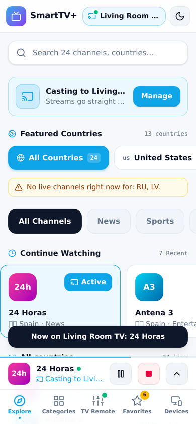
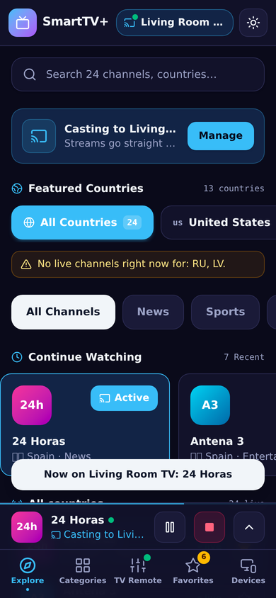

# SmartTV+ Cast — verified free international live TV on your phone, cast to any Chromecast

A static, phone-first web app (PWA) hosted on GitHub Pages, with **light and dark mode**. It shows **only channels that
passed a stream health check**, plays them on the phone with hls.js and casts them to a Chromecast with the Google Cast
Web Sender. A scheduled GitHub Action re-checks the streams every 6 hours and redeploys. No server, no database.

**Live URL (after setup):** https://maikrogerio.github.io/SmartTV/

| Light | Dark |
|---|---|
|  |  |

## Screens
| Tab | What it does |
|---|---|
| **Explore** | Search, Chromecast status card, 13 featured countries (zero-live ones flagged), category pills, Continue Watching, live list |
| **Categories** | Category tiles with live counts → channel list |
| **TV Remote** | While casting: big play/pause, previous/next, favorite, stop, "Up next" |
| **Favorites** | Your starred channels that are live right now (badge = count) |
| **Devices** | Connect / disconnect the Chromecast, channel-check evidence, per-country coverage, theme (Light / Dark / Auto) |

Header: cast pill (TV name + green dot when connected) and a light/dark toggle. A mini player sits above the tab bar while casting.

## How it works
```
GitHub Action (every 6 h)                         Phone (Chrome / Safari)
  iptv-org playlist                                 loads public/data/channels.verified.json
  -> 13 featured countries, 60 streams each         -> Rule 1 gate (lib/verified.ts)
  -> health check (lib/streamChecker.ts)            -> hides channels that failed on this phone
  -> public/data/channels.verified.json  -------->  -> plays (hls.js) or casts (Default Media Receiver)
  -> tests -> build -> deploy to Pages
```

## Rules
1. **Never show an unverified channel.** The Action only publishes streams that passed the check. The app accepts a
   channel only if it has an https URL, needs no custom headers and has a valid `checkedAt`. A broken or missing file
   shows **nothing**, because there is no fallback list. A channel that does not start within 15 s is hidden on that phone for 3 days.
2. **The 13 featured countries always include US, GB, MX, RU and AR** (`lib/featured-countries.ts`, enforced by a test).
   Any featured country with 0 live channels is flagged in Explore, in Devices → Country coverage, in the job log and the job summary.

## Featured countries
US · GB · MX · RU · AR · ES · PT · IT · BR · RO · LT · LV · HR

## Local development
```bash
npm install                       # creates package-lock.json — commit it
npm test                          # vitest: parser, checker, catalog, Rule 1 gate + render, Rule 2, theme
npm run check:streams:quick       # refreshes public/data/channels.verified.json
npm run dev                       # http://localhost:5173
npm run build && npm run preview  # production build (service worker active)
```
Casting needs HTTPS, so it works on the Pages URL, not on `localhost` from a phone.

## Deploy to GitHub Pages (one-time)
1. Repo **Settings → Pages → Build and deployment → Source: GitHub Actions**.
2. Repo must be **public** for free Pages on a personal account. The code and the channel list will be visible.
3. Push this folder to `main` (see "First push"). The push builds and deploys the current list.
4. **Actions → Refresh channels and deploy → Run workflow** to run the first stream check now (otherwise every 6 h).

### First push (run on your laptop)
```bash
git clone https://github.com/MaikRogerio/SmartTV.git
cd SmartTV
# copy the contents of this folder here (keep the .github folder)
cp <your old project>/data/channels.verified.json public/data/channels.verified.json   # optional: start with your 276 verified channels
npm install && npm test
git add . && git commit -m "SmartTV+ Cast: phone-first PWA, light/dark, scheduled stream check"
git push origin main
```

## Using it
- **Cast:** Chrome on Android, same Wi-Fi as the Chromecast → tap the cast pill or **Connect** → pick the TV → tap any channel.
- **iPhone/iPad:** plays on the phone; **casting is not supported** (no Cast Web Sender in iOS browsers). The app says so.
- **Theme:** moon/sun button in the header, or Devices → Appearance (Light / Dark / Auto follows the phone).
- **Install:** Chrome menu → *Add to Home screen* / *Install app*.

## Scheduled job
`.github/workflows/refresh-and-deploy.yml`
| Trigger | What runs |
|---|---|
| every 6 h, or *Run workflow* | stream check → commit list if changed → tests → build → deploy |
| push to `main` | tests → build → deploy (no re-check) |

Guards in `scripts/check-streams.ts`: 0 playable streams, or fewer than 50% of last time, means **no publish** (job fails, the old list stays).
Override with *Run workflow → force*. Zero-live countries raise a **warning**; add `--fail-on-zero` to make them block the deploy.

## Known limits
- **Geo-blocking:** the check runs from GitHub's servers (mostly US). Some channels pass there and fail on your phone, or the reverse.
  Failed channels are hidden on the phone automatically.
- **Chromecast format:** the Default Media Receiver plays most HLS streams; a few play on the phone but not on the TV (the remote shows a message).
- **Flags:** Windows does not draw flag emoji, so on a Windows PC they appear as letters; Android and iPhone show flags.
- **Inactive repos:** GitHub pauses scheduled workflows after 60 days without repository activity; the bot commits normally keep it active.
- Free, public streams from iptv-org only. No paid or pirated sources.
